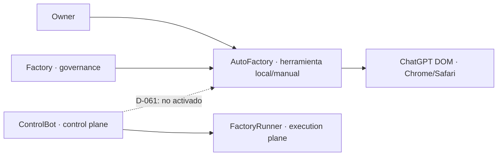

# ChatGPT Autopilot Local — Chrome y Safari

> Herramienta local/manual del dueño para mantener flujos de ChatGPT activos de forma controlada. No es un servidor web ni el execution plane de la fábrica.

**Rol en la fábrica:** local/manual tool · **Fase:** construction · **Roadmap:** GitHub Issues + [AutoFactory #1](https://github.com/pl0n3r/AutoFactory/issues/1)

AutoFactory supervisa chats habilitados usando el DOM real de ChatGPT. No usa capturas, coordenadas, posición de ventanas ni `pyautogui`; no pulsa aprobaciones, permisos, compras ni acciones destructivas; el modelo solo cambia según la preferencia explícita del usuario. Chrome y Safari comparten el mismo núcleo y el puente con ControlBot permanece sin tráfico real hasta satisfacer D-061 y sus puertas legales/seguridad.

## Operational Cockpit

[](https://github.com/pl0n3r/AutoFactory/actions/workflows/validate.yml)
[](https://github.com/pl0n3r/AutoFactory/releases)

- **Pruebas:** [Validate sobre main](https://github.com/pl0n3r/AutoFactory/actions/workflows/validate.yml); éxito en CI no acredita instalación Chrome/Safari.
- **Paquetes:** [Releases oficiales](https://github.com/pl0n3r/AutoFactory/releases), última versión comprobada: [v1.7.37](https://github.com/pl0n3r/AutoFactory/releases/tag/v1.7.37).
- **Orquestador:** [ControlBot, consola privada](https://control.condorapp.com.co/). Este enlace no activa pairing ni tráfico real.
- **Instalación Safari:** [#122 — smoke real pendiente](https://github.com/pl0n3r/AutoFactory/issues/122).

## Estado de la versión publicada

La versión **1.7.37** corrige la admisión de identificadores de pestaña de hasta diez dígitos; **1.7.36** incorporó un permiso LAN opcional que Chrome solicita al usuario para direcciones IPv4 privadas validadas. Fuente: [CHANGELOG.md](CHANGELOG.md). Esas capacidades no autorizan por sí mismas el puente con ControlBot ni sustituyen la puerta legal D-061.

## Work Queue

- **NOW:** [Issues críticos abiertos](https://github.com/pl0n3r/AutoFactory/issues?q=is%3Aissue%20is%3Aopen%20label%3A%22prioridad%3A%20cr%C3%ADtica%22) y [PRs abiertos](https://github.com/pl0n3r/AutoFactory/pulls?q=is%3Apr%20is%3Aopen). El estado actual lo determina GitHub, no este README.
- **NEXT:** [#226 — estados de sesión offline](https://github.com/pl0n3r/AutoFactory/issues/226) y [#228 — paridad Chrome/Safari](https://github.com/pl0n3r/AutoFactory/issues/228), según dependencias y reservas.
- **LATER:** [#134 — readiness del bridge](https://github.com/pl0n3r/AutoFactory/issues/134), sin anticipar go-live.
- **BLOCKED:** [#219 — SonarCloud](https://github.com/pl0n3r/AutoFactory/issues/219), [#220 — required checks](https://github.com/pl0n3r/AutoFactory/issues/220) y [#1 — pairing real](https://github.com/pl0n3r/AutoFactory/issues/1).

La cola real vive en los Issues; esta portada no calcula progreso, readiness ni capacidad operacional.

## Qué hace el producto

AutoFactory es una **extensión local/manual** de Chrome y Safari, no un servidor ni el plano de ejecución de Factory ([AGENTES.md](AGENTES.md), [manifest](manifest.json)).

- Observa únicamente las pestañas habilitadas y espera a que ChatGPT termine antes de continuar usando el DOM y el compositor reales ([autopilot-core.js](autopilot-core.js), [content.js](content.js)).
- Gestiona estados transitorios, reintentos seguros y varias pestañas locales, con diagnóstico minimizado ([CHANGELOG.md](CHANGELOG.md)).
- Conserva contratos offline para ControlBot, sin asumir pairing o transporte real, bajo [#1](https://github.com/pl0n3r/AutoFactory/issues/1) y [D-061](AGENTES.md).

No automatiza compras, permisos, MFA, CAPTCHA, acciones destructivas ni evasión de límites de la plataforma.

## Arquitectura en 60 segundos



- [Factory](https://github.com/pl0n3r/factory) aporta gobernanza; [ControlBot](https://github.com/pl0n3r/ControlBot) mantiene el control plane y [FactoryRunner](https://github.com/pl0n3r/FactoryRunner) es el ejecutor independiente.
- Chrome utiliza [Manifest V3](manifest.json); el [proyecto Safari](safari/) comparte fuentes web, pero la instalación real necesita el [smoke #122](https://github.com/pl0n3r/AutoFactory/issues/122).
- El puente AutoFactory ↔ ControlBot sigue declarativo hasta satisfacer [#129](https://github.com/pl0n3r/AutoFactory/issues/129) y las puertas legales.

## Stack e infraestructura

- **Extensión:** JavaScript para [Chrome Manifest V3](manifest.json) y contenedor nativo [Safari/Xcode](safari/) ([AGENTES.md](AGENTES.md)).
- **Pruebas:** Node.js ≥20 y [npm test](package.json). No existe backend Hostinger ni base de datos propios.
- **Permiso LAN opcional:** [CHANGELOG 1.7.36](CHANGELOG.md); no equivale a autorización permanente de red.
- **Releases:** [GitHub Releases](https://github.com/pl0n3r/AutoFactory/releases); paridad de manifiestos y rollback al paquete anterior antes de declararla instalable.

## Ciclo de entrega

Issue → estado/reserva → `trabajo/issue-N` → PR → tests/Factory gates → revisión → merge serial → release oficial → smoke de instalación/carga Chrome/Safari.

Cuando el bot de coordinación no esté instalado, `AGENTES.md` permite fallback local: comentario de plan + `estado: reservado` sin inventar UUID. Una vez instalada coordinación Factory, se usa el flujo canónico.

Un merge o CI verde no equivale a producción VERDE de AutoFactory. La entrega instalable exige evidencia de release y smoke de la extensión.

## Calidad y seguridad

- No registrar texto de chats, tokens, correos ni IDs identificables de conversación.
- No automatizar aprobaciones, permisos, compras, CAPTCHA, MFA ni acciones destructivas.
- No eludir rate limits ni controles de plataforma.
- Toda modificación de tratamientos personales exige actualizar `datos.yml` y aplicar puertas legales.
- Mantener release anterior instalable como rollback.
- Preservar paridad Chrome/Safari.
- El puente con ControlBot permanece sin tráfico real, pairing o tratamientos reales hasta D-061.

## Roadmap y fuentes de verdad

- **Puente y alcance:** [roadmap #1](https://github.com/pl0n3r/AutoFactory/issues/1) y [readiness #134](https://github.com/pl0n3r/AutoFactory/issues/134).
- **Ejecución y revisiones:** [Issues](https://github.com/pl0n3r/AutoFactory/issues) y [PRs](https://github.com/pl0n3r/AutoFactory/pulls).
- **Decisiones y límites:** [decisiones.yml](decisiones.yml), [AGENTES.md](AGENTES.md), [datos.yml](datos.yml).
- **Versiones reales:** [CHANGELOG.md](CHANGELOG.md) y [GitHub Releases](https://github.com/pl0n3r/AutoFactory/releases).
- **Protocolo transversal:** [PLAN-AGENTES.md](https://github.com/pl0n3r/factory/blob/main/PLAN-AGENTES.md).

No inferir instalación, operación real, salud o consentimiento desde este README.

## Desarrollo local

Requisitos: Node.js >=20. Para Safari, macOS + Xcode.

```bash
npm ci --ignore-scripts --no-audit --no-fund
npm test
```

Para Safari:

```bash
./build-safari.sh
```

No se requieren credenciales reales para ejecutar la suite local.

## Mapa de la fábrica

- **Factory** — governance/kit y contratos comunes.
- **ControlBot** — control plane, priorización, elegibilidad y estado durable.
- **FactoryRunner** — execution plane; ejecuta órdenes ya gobernadas y reporta evidencia.
- **Condor / GrindFlow / BRVTAL** — productos construidos por la fábrica.
- **AutoFactory** — herramienta local/manual del dueño para continuidad de chats.

AutoFactory no se fusiona con FactoryRunner: pueden coexistir, pero sus autoridades, runtime y ciclo de entrega son distintos.

## Instalación y uso

### Instalar en Chrome

1. Abre `chrome://extensions`.
2. Activa **Modo de desarrollador**.
3. Pulsa **Cargar descomprimida**.
4. Selecciona la carpeta raíz que clonaste.
5. Recarga las pestañas de ChatGPT que ya estaban abiertas.

### Instalar en Safari

1. Clona el repositorio en macOS con Xcode instalado.
2. Ejecuta `./build-safari.sh` desde la raíz.
3. Abre `safari/ChatGPT Autopilot Local.xcodeproj`.
4. En Xcode, selecciona tu equipo de firma si macOS lo solicita y pulsa **Run**.
5. Abre Safari > Ajustes > Extensiones, activa **ChatGPT Autopilot Local**, permite acceso a `chatgpt.com` y recarga las pestañas abiertas.

Chrome y Safari comparten el mismo núcleo y selectores DOM. `build-safari.sh` sincroniza la fuente web con el contenedor nativo antes de compilar.

### Usar

Pulsa **ACTIVAR TODAS** una vez. Las pestañas habilitadas trabajan de forma independiente y **PAUSAR TODAS** detiene el piloto global.

La extensión escribe en `#prompt-textarea`, relee el mensaje exacto y solo pulsa el botón real `#composer-submit-button` / `data-testid="send-button"`. Si no encuentra esos elementos, no envía nada.

Antes de cada envío exige lecturas consecutivas e idénticas del campo. Si React/ChatGPT altera el texto durante ese intervalo, cancela el envío para evitar duplicados.

## Confiabilidad y memoria adaptativa local

AutoFactory conserva muestras locales de tiempos de inicio/respuesta, ciclos, recuperaciones y fallos para ajustar umbrales de detección de bloqueos. Esa memoria permanece en el navegador y no guarda el texto de las conversaciones.

Ante conexiones interrumpidas, espera recuperación antes de cancelar o recargar. Los envíos pendientes se conservan de forma que reduzca duplicados y se aplica backoff/circuit breaker cuando los fallos se repiten.

El seguimiento visual usa desplazamiento progresivo de contenedores relevantes y respeta pausas manuales. Las acciones automáticas permitidas se limitan a esperas, recarga controlada, **Reintentar** y **Continuar generando**; autenticación o autorización requieren intervención humana.

## Estado local por pestaña

El popup muestra una tarjeta **Estado de pestañas** con el alias local de cuenta, último envío, última respuesta, límite temporal, pausa y señal **SIN AVANCE**. El umbral es configurable y parte de 30 minutos.

**SIN AVANCE** significa una de dos cosas: no llegó respuesta después del umbral o varias respuestas consecutivas conservaron la misma huella hash durante ese periodo. No implica por sí solo un fallo de ChatGPT. Abre la pestaña indicada, revisa si está pausada o en límite y, si hace falta, reanuda o corrige el trabajo desde la propia conversación.

El badge de la extensión muestra cuántas pestañas están en **SIN AVANCE**. El registro de salud conserva como máximo 200 eventos y solo guarda marcas de tiempo, estado, identificador local de pestaña y huellas hash; nunca texto de conversación.

## Log de diagnóstico

El service worker conserva un historial local acotado de eventos técnicos. No guarda mensajes ni contenido del chat; las rutas se anonimizan por categoría y se excluyen identificadores de conversación. **COPIAR LOG** produce una salida sanitizada y **BORRAR LOG** elimina la copia local.

Consulta [CHANGELOG.md](CHANGELOG.md) para el detalle histórico de versiones y cambios.
